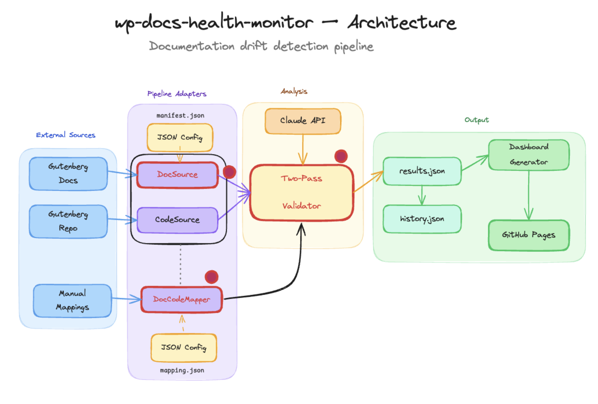

# wp-docs-health-monitor

Automated health monitor for WordPress-hosted developer documentation sites.

> [!NOTE]
> The dashboard is deployed at https://juanma-wp.github.io/wp-docs-health-monitor/

The tool compares docs against their underlying source code and produces an evidence-backed, scored report of drift — outdated APIs, missing parameters, broken examples, deprecated usage — with suggested fixes, rendered as a static HTML dashboard.



see [diagram](https://excalidraw.com/#json=NQXUcZaoSsTj6SHnI4Z_F,W7sPJGcKmJ_-6fnPgZ99Nw) 

> [!NOTE]
> Read [Building a Health Monitor Dashboard for WordPress Docs](https://juanma.codes/2026/05/12/building-a-health-monitor-dashboard-for-wordpress-docs/) for a deep dive on the project

## Quick start

Real validator results are committed to this repo, so you can see actual dashboards **without an API key and at zero cost** — just rebuild the HTML from the stored data:

```bash
npm install
npm run rebuild        # regenerates every site dashboard from committed results.json
```

Then open `out/index.html` (the cross-site landing page) or a specific site such as `out/gutenberg-block-editor/index.html`.

The five commands that cover the whole workflow:

| Command | What it does | Cost |
|---------|--------------|------|
| `npm install` | Install dependencies. | — |
| `npm run rebuild` | Rebuild **all** dashboards + the cross-site meta-index from committed `results.json`. No network, no API. | free |
| `npx tsx scripts/auto-map.ts --all --config config/<site>.json --dry-run` | Plan the slug→code mapping for a site (drop `--dry-run` to build it). | free in dry-run / `--no-rerank` |
| `npm run analyze -- --config config/<site>.json` | Run the validator over a whole corpus and write a fresh dashboard. | **billable** (Anthropic API) |
| `npm run analyze -- --results examples/mock-results.json --output ./out` | Render a dashboard from a single pre-computed results file (synthetic example). | free |

Everything below expands on these.

## Prerequisites

- Node.js ≥ 20
- `ANTHROPIC_API_KEY` (required for live pipeline runs)

## Install

```bash
npm install
```

## Environment setup

`ANTHROPIC_API_KEY` must be set in the environment before running the live pipeline. How you provide it is up to you:

```bash
# Inline
ANTHROPIC_API_KEY=sk-ant-... npm run analyze -- --config config/gutenberg-block-api.json

# Exported in your shell session
export ANTHROPIC_API_KEY=sk-ant-...
npm run analyze -- --config config/gutenberg-block-api.json

# Add it to an `.env` file on the root of the folder's project
```

**Optional:** set `GITHUB_TOKEN` to authenticate the `manifest-url` DocSource's GitHub Commits API calls (used to populate each doc's `lastModified` field). Without it you'll hit the 60/hr anonymous rate limit after ~50 docs.

## Usage

### Simplest way to run it

```bash
npm run analyze -- --config config/wp-theme-handbook.json
```

That single flag is all you need. Here's exactly what it does:

- **Analyzes the whole corpus.** With no `--slug`, there's no filter — every doc in the config's manifest is validated (minus any `docSource.ignore` entries).
- **Clones the configured `codeSources` repos** and calls the Anthropic API once per mapped doc. This is a real, billable run with no confirmation prompt — see [Cost note](#cost-note).
- **Derives the output directory** from the config since `--output` is omitted: `<outputDir>/<config-filename>/`, e.g. `./out/wp-theme-handbook/`.
- **Writes the run** to `data/runs/<runId>/results.json`, updates `data/history.json`, and regenerates the dashboard. It finishes with `Dashboard written to out/wp-theme-handbook/index.html`.

To start safely without spending anything, add `--dry-run` (just validates the config and prints what would run) or scope to a single page with `--slug <slug>`.

### Run against live docs (requires config + API key)

```bash
npm run analyze -- --config config/gutenberg-block-api.json
```

The dashboard lands in `./out/gutenberg-block-api/` (derived from the config — see [Simplest way to run it](#simplest-way-to-run-it)). Pass `--output <dir>` to override.

### Preview with mock data (no API key needed)

```bash
npm run analyze -- --results examples/mock-results.json --output ./out
```

Then open `./out/index.html` in your browser.

### Regenerate dashboards from existing results

Dashboards are pure derivations of the committed `results.json` files — no API calls needed to (re)build the HTML. There are two ways to do it:

```bash
# Bulk: rebuild EVERY site's dashboard + the cross-site meta-index from all
# committed out/<site>/data/runs/<runId>/results.json files. This is what CI
# runs before deploying to GitHub Pages; it's idempotent.
npm run rebuild

# Single file: render one dashboard from one results file.
npm run analyze -- --results out/wp-theme-handbook/data/runs/<runId>/results.json --output ./out
```

Use `npm run rebuild` after editing templates, pulling new committed runs, or whenever you want fresh HTML. Use `--results` when you have one specific results file (e.g. the synthetic `examples/mock-results.json`) and want just that dashboard.

### Feed review verdicts back into the validator

Every reviewed report makes the next run better. Record verdicts on a run's findings and the tooling turns them into calibration guidance in the site's prompt extension, plus a per-site precision trend:

```bash
# Skeleton with every reported issue pre-listed as "pending"
npm run feedback -- init --site gutenberg-block-editor --run <runId>

# ...edit feedback/<site>/<runId>.json: verdicts, notes, missed drift...

# Regenerate the prompt's AUTO-CALIBRATION block + feedback/<site>/metrics.json
npm run feedback -- apply
```

Pushing verdict files to `main` triggers the `feedback-loop` workflow, which runs `apply` and opens a PR with the regenerated calibration — merge it and the next run has learned from the review. Full cycle: [`docs/reference/FEEDBACK.md`](docs/reference/FEEDBACK.md).

## CLI flags

| Flag | Description |
|------|-------------|
| `--config <path>` | Path to a config JSON file. Required unless `--results` is provided. |
| `--output <dir>` | Output directory for the dashboard. Optional — when omitted with `--config`, it's derived as `<config.outputDir>/<config-filename>/`. Required when only `--results` is provided. |
| `--results <path>` | Load a pre-computed `RunResults` JSON instead of running the pipeline. |
| `--slug <slug...>` | Only validate the given doc slug(s); repeatable (pipeline runs only). |
| `--dry-run` | Print what would be analyzed without running the pipeline. Requires `--config`. |

`--results` and `--config` are mutually exclusive for pipeline execution.

## Config file reference

```json
{
  "project": { "name": "Gutenberg Block API" },
  "docSource": {
    "type": "manifest-url",
    "manifestUrl": "https://...",
    "parentSlug": "block-api",
    "sourceUrlBase": "https://developer.wordpress.org/block-editor/"
  },
  "codeSources": {
    "gutenberg": {
      "type": "git-clone",
      "repoUrl": "https://github.com/WordPress/gutenberg.git",
      "ref": "trunk"
    }
  },
  "mappingPath": "config/gutenberg-block-api-mapping.json",
  "outputDir": "./out",
  "validator": {
    "type": "claude",
    "model": "claude-sonnet-4-6"
  }
}
```

## Cost note

Each pipeline run calls the Anthropic API once per doc. With `claude-sonnet-4-6`, a full run over ~10 docs costs roughly $1–$3 depending on doc length and code context size. Use `--results` with `examples/mock-results.json` to explore the dashboard at zero cost.

The estimated cost is stored in `results.json` under `usage.estimatedCostUsd` and appended to `data/history.json` after each run. It is calculated from the token counts returned by the API using the prices configured in `config.pricing`. The defaults match the current Sonnet 4.6 rates — check [Anthropic's pricing page](https://www.anthropic.com/pricing) for updates and adjust `config.pricing` in your config file if needed.

## Dev config overrides

Each config file supports a local `.dev.json` override loaded automatically when present. For example, alongside `config/gutenberg-block-api.json` you can create `config/gutenberg-block-api.dev.json` (gitignored) to override specific settings without touching the base config:

```json
{
  "validator": {
    "pass1Model": "claude-haiku-4-5-20251001",
    "pass2Model": "claude-haiku-4-5-20251001"
  }
}
```

The override is deep-merged into the base config — only the keys you specify are replaced. This is the recommended way to use cheaper models during development. See `config/gutenberg-block-api.json` for all available settings.

## Customising for your own docs

To monitor a different WordPress doc site or doc section, you supply two JSON files:

### 1. A config file — `config/<your-site>.json`

```json
{
  "project":   { "name": "Your Docs" },
  "docSource": {
    "type":          "manifest-url",
    "manifestUrl":   "https://raw.githubusercontent.com/OWNER/REPO/BRANCH/docs/manifest.json",
    "parentSlug":    "your-section",
    "sourceUrlBase": "https://developer.example.com/your-section/"
  },
  "codeSources": {
    "my-repo": {
      "type":    "git-clone",
      "repoUrl": "https://github.com/OWNER/REPO.git",
      "ref":     "trunk"
    }
  },
  "mappingPath": "mappings/your-site.json",
  "outputDir":   "./out",
  "validator":   { "type": "claude", "model": "claude-sonnet-4-6" }
}
```

Keys of note:
- `parentSlug` filters the manifest to a single section — start narrow.
- `sourceUrlBase` is optional; omit it to get GitHub-UI `/blob/` URLs as `Doc.sourceUrl`.
- Each key under `codeSources` (`my-repo`, `gutenberg`, `wordpress-develop`, …) becomes a valid `repo` value in the mapping file. A mapping entry that references a repo not listed here will fail config validation at construction time.

### 2. A mapping file — `mappings/<your-site>.json`

Slug-keyed, tiered code references. Tiers hint at token-budget priority: `primary` (≤3) is always sent to the validator, `secondary` (≤5) is added next, `context` (≤8) is dropped first under token pressure.

```json
{
  "your-doc-slug": {
    "primary":   [{ "repo": "my-repo", "path": "src/api.ts" }],
    "secondary": [{ "repo": "my-repo", "path": "src/api-helpers.ts" }],
    "context":   []
  }
}
```

See `mappings/gutenberg-block-api.json` for a real example.

#### Auto-map a docs site

Curating these tiers by hand is tedious. **`scripts/auto-map.ts` is the canonical way to build a mapping.** It clones the configured `codeSources`, builds a symbol index, scores candidate files against the symbols each doc references, and (optionally) runs an AI re-ranker to pick the final tiers. It writes directly to the config's `mappingPath`. It's a dev-time accelerator, not a runtime component — review the output before committing.

```bash
# Plan first — prints the per-slug action plan and exits before any clone or
# LLM call. Zero cost, fast. Refuses slugs excluded by docSource.ignore.
npx tsx scripts/auto-map.ts --all --config config/your-site.json --dry-run

# Build the whole mapping. Resumable: slugs already present are skipped
# (add --force to re-map them). Implies --write.
npx tsx scripts/auto-map.ts --all --config config/your-site.json

# Map (or re-map) a single slug. --write persists; without it, prints only.
npx tsx scripts/auto-map.ts <slug> --config config/your-site.json --write
```

Key flags: `--no-rerank` skips the AI step for **lexical-only, zero-API-cost** output (good for a first coverage pass — see the cost note below); `--explain` prints why each file was kept or dropped; `--force` re-maps slugs already in the file.

> **Cost flag for `parentSlug: "*"`:** a large manifest (e.g. Gutenberg's ~426 entries) means re-ranking hundreds of slugs in one `--all` run. Do a first pass with `--no-rerank` to sanity-check coverage before paying the LLM cost.

Re-running auto-map on a slug overwrites its entry; hand-edits and auto-regeneration coexist by overwrite, with git history as the audit trail. See [`docs/reference/MAPPING.md`](./docs/reference/MAPPING.md) for the full reference.

**Fallback — `scripts/bootstrap-mapping.ts`:** an older, AI-only single-slug helper that asks Claude to propose a `CodeTiers` entry from the doc content and repo file tree. Reach for it only if auto-map produces unusably thin coverage for a slug:

```bash
export ANTHROPIC_API_KEY=sk-ant-...
npx tsx scripts/bootstrap-mapping.ts <slug> --config config/your-site.json
```

## For contributors

See [`DEVELOPMENT.md`](./DEVELOPMENT.md) for local setup, development commands, the smoke-test pipeline, the Ralph autonomous workflow, and project status.

## License

MIT
